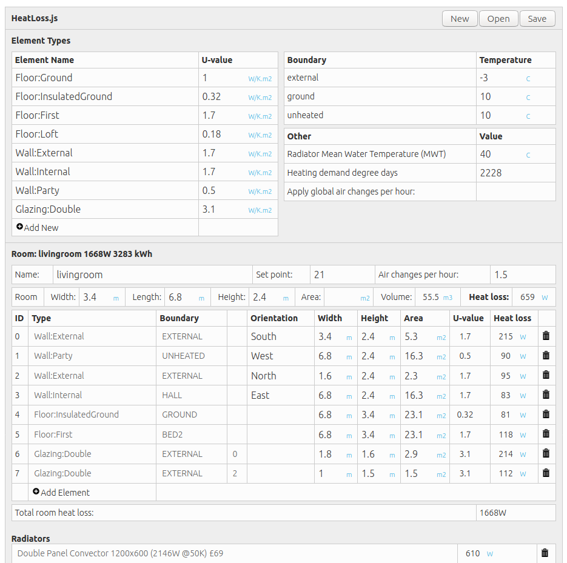

# HeatLossJS

A small open source room by room heat loss calculator

Create html page, load heatloss.js tool with the following:

    
    
    
    
    
    <link rel="stylesheet" type="text/css" href="heatlossjs/style.css" />
    

    
    
    
    
Define your building in json object input definition (loaded in the first line above).

### Floor plan builder

Open [floorplan.php](floorplan.php) to draw the building instead of typing in each element. The floor plan code lives in [floorplan/](floorplan/) and uses the shared calculation in heatlossjs/calc.js.

- Drag to draw rooms on a grid, rooms that touch (or are within the wall gap) share a wall automatically.
- Rooms are drawn to their inside dimensions and walls are drawn with their thickness: the gap between two rooms is the internal wall, external and party walls are drawn outwards at a default thickness that can be changed per wall. Floor and ceiling area that sits over or under a wall on the next storey is not counted as exposed floor or roof.
- Click on walls to add windows and doors, click a wall to mark it as a party wall or change its construction.
- Add floors, the floor below is shown faintly to trace over. Floors and ceilings between rooms are worked out from the overlap, with ground below the bottom floor and roof above any area not covered.
- Wall orientations come from the north arrow.
- Heat loss is calculated as you go using the same calculation (heatlossjs/calc.js), and shown as a heat map on the plan.

Saved files are standard heatlossjs json with the plan stored under a `floorplan` key, so they open in both tools. *Table view* opens the generated calculation in the original table interface.

Examples: 

- [midterrace_data.js](files/midterrace_data.js)
- [bothylab_data.js](files/bothylab_data.js)
- [mainhouse_data.js](files/mainhouse_data.js)
- [study_data.js](files/study_data.js)

Examples with notes on input values:

- [Mid Terrace house](https://trystanlea.org.uk/roombyroomheatloss2)
- [Bothy](https://trystanlea.org.uk/bothy)
- [Detached house](https://trystanlea.org.uk/house)

### Heatlossjs adaptations and forks

- **heatlossjsITA** An Italian adaptation of heatlossjs developed by @jumpjack. New features include taking into account different rates of heat loss from external walls depending on orientation as well as translation to Italian. https://github.com/jumpjack/heatlossjsITA
